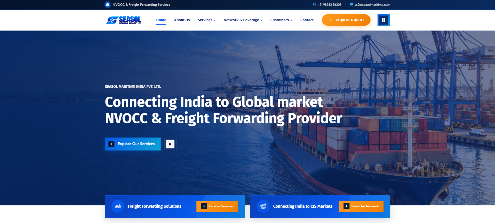
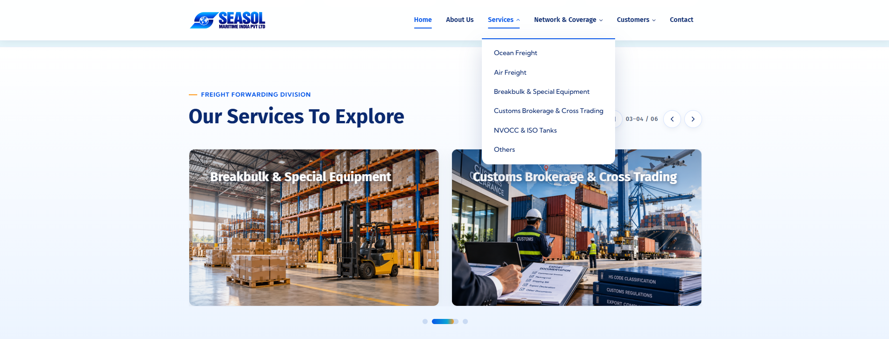
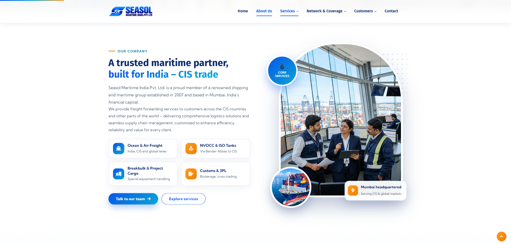
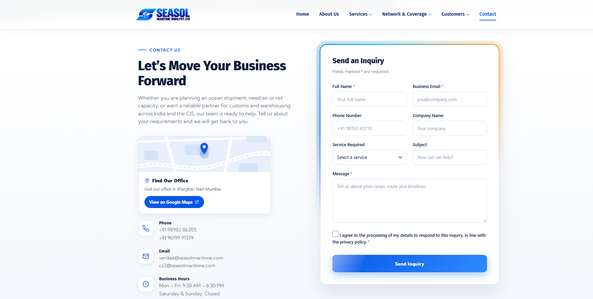

::: {align="center"}
# ⚓ Seasol Maritime India Pvt. Ltd.

### Connecting Businesses. Moving the World.

**Corporate Website · Maritime Logistics · Freight Solutions**

[](https://github.com/jayeshshinde700/Seasol-Maritime)
[](#technology-stack)
[](#)
:::

------------------------------------------------------------------------

## 🌐 Project Overview

A responsive corporate website developed for **Seasol Maritime India
Pvt. Ltd.** The website presents the company's maritime and freight
services, international network, customer relationships, and company
information through a modern, user-friendly interface.

Built with standard front-end technologies, the website can be served
directly from a web server such as Apache/XAMPP. No CMS or build process
is required.

## ✨ Website Highlights

-   **Corporate homepage** --- introduces the company and its services.
-   **Service pages** --- dedicated information for Ocean Freight, Air
    Freight, Customs Brokerage, NVOCC & ISO Tanks, Breakbulk & Special
    Equipment, and other services.
-   **International network** --- showcases the company's global
    coverage.
-   **Customers & partners** --- presents business relationships.
-   **Company information** --- About Us, values, and related content.
-   **Contact page** --- provides visitors with a way to connect.
-   **Responsive layout** --- designed to work across desktop, tablet,
    and mobile screens.

## 🖼️ Website Preview

> The screenshots below are stored in the repository's `screenshots/`
> folder.

  ---------------------------------------------------------------------------
               Homepage                              Services
  ----------------------------------- ---------------------------------------
      

  ---------------------------------------------------------------------------

  -------------------------------------------------------------------------
         International Network                Customers & Partners
  ----------------------------------- -------------------------------------
               Partners](screenshots/customer.png)

  -------------------------------------------------------------------------

  -------------------------------------------------------------------------
               About Us                              Contact
  ----------------------------------- -------------------------------------
     

  -------------------------------------------------------------------------

## 🧭 Website Pages

  Page                                 Description
  ------------------------------------ ---------------------------------
  `index.html`                         Main homepage
  `about-us.html`                      Company overview
  `ocean-freight.html`                 Ocean freight services
  `air-freight.html`                   Air freight services
  `customs-brokerage.html`             Customs brokerage services
  `nvocc-iso-tanks.html`               NVOCC and ISO tank solutions
  `breakbulk-special-equipment.html`   Breakbulk and special equipment
  `other-services.html`                Additional services
  `international-network.html`         International network
  `customers-partners.html`            Customers and partners
  `contact.html`                       Contact information

The repository may also contain supporting pages and assets used by the
website.

## 🛠️ Technology Stack

-   **HTML5** --- page structure and content
-   **CSS3** --- styling and responsive layouts
-   **JavaScript** --- interactive website behaviour
-   **Bootstrap** --- layout and interface components
-   **jQuery** --- supporting front-end interactions
-   **Apache / XAMPP** --- local development and testing

## 📁 Project Structure

``` text
Seasol-Maritime/
├── contact-section/
├── css/                 # Stylesheets
├── fonts/               # Font files
├── images/              # Website images and visual assets
├── js/                  # JavaScript files
├── screenshots/         # Website preview images
├── index.html           # Homepage
├── about-us.html
├── ocean-freight.html
├── air-freight.html
├── customs-brokerage.html
├── nvocc-iso-tanks.html
├── breakbulk-special-equipment.html
├── international-network.html
├── customers-partners.html
├── other-services.html
└── contact.html
```

## 🚀 Run Locally

1.  Install [XAMPP](https://www.apachefriends.org/).

2.  Copy the project folder into the XAMPP `htdocs` directory.

3.  Open the XAMPP Control Panel and start **Apache**.

4.  Visit the local project URL in your browser:

    ``` text
    http://localhost/seasol/
    ```

    If you use a different folder name, replace `seasol` in the URL with
    that folder name.

## 👥 Credits

-   **Website Developers:** Naman Shetty & Jayesh Shinde
-   **Development Agency:** HS Digital Media
-   **LinkedIn:** [Naman
    Shetty](https://www.linkedin.com/in/naman-shetty-dev/)

------------------------------------------------------------------------

::: {align="center"}
**Seasol Maritime India Pvt. Ltd.**

*Website project repository*
:::
